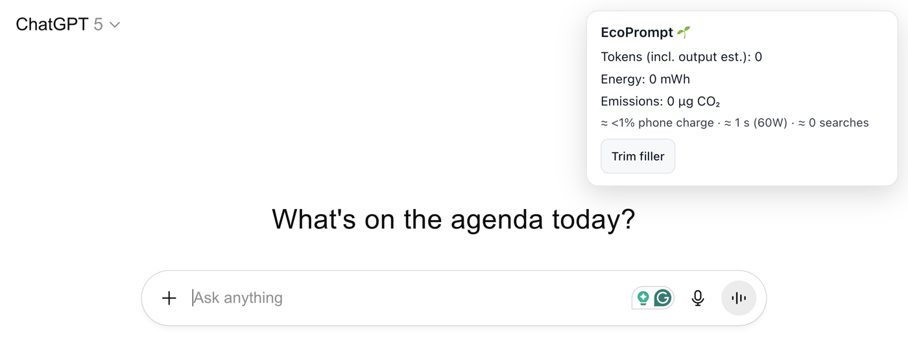
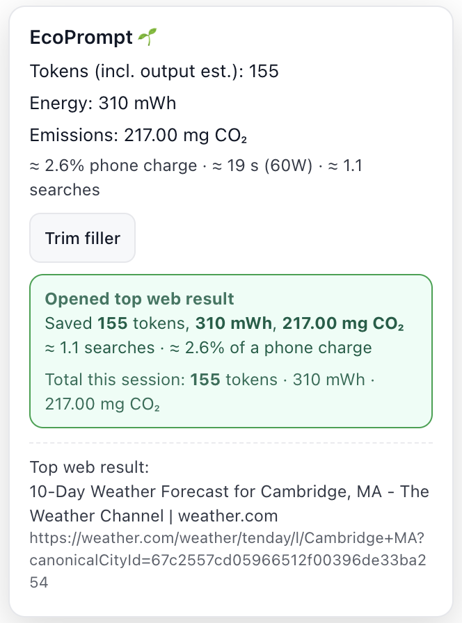
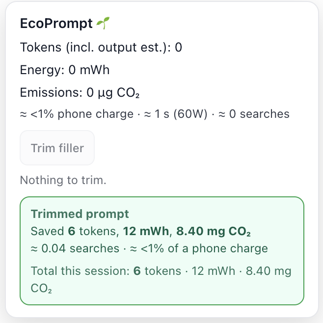

# EcoPrompt 🌱

A Chrome extension that shows the energy and CO₂ cost of every ChatGPT prompt while you type it, and trims filler words before you send.

🏆 **3rd place, Infosys Carbon-Conscious AI track at HackMIT 2025.**

| Live estimate as you type | After sending: what a search would have cost | Trimmed prompt |
|---|---|---|
|  |  |  |

> This repo is the simplified, store-ready extension. The hackathon build also had a companion dashboard (leaderboards, streaks, tips) that isn't included here.

## What it does

- **Live estimate.** Tokens, energy (mWh) and emissions (CO₂) for the prompt you're typing, including an estimate of the reply, with everyday comparisons: share of a phone charge, seconds of a 60 W bulb, equivalent Google searches.
- **Trim filler.** One click removes filler phrases ("just", "basically", "I was wondering if…") from the prompt box. It is plain string filtering with a bundled phrase list (`src/data/fillers.txt`), no model call, and the button only enables when there is something to trim.
- **Search instead.** For a prompt that a search could answer, the panel shows the top web result (title and link, resolved via a Google "I'm Feeling Lucky" lookup). Opening it counts the whole prompt as saved.
- **Session totals.** Tokens, energy and CO₂ you've saved are kept in `chrome.storage.local`.
- **Popup calculator.** Enter a token count and see the conversion on its own.

## How the numbers work

```
tokens   = input tokens + estimated output tokens      (output ≈ max(150, 1.5 × input))
energy   = tokens ÷ tokens-per-kWh
CO₂      = energy × grams-CO₂-per-kWh
```

Three assumption profiles are in `src/lib/co2.ts` (conservative, typical, extreme). The ChatGPT panel uses the high-end one, so treat the output as a cautious order-of-magnitude estimate, not a measurement. Tokens are counted with `gpt-tokenizer`, falling back to length ÷ 4.

## Install from source

Requirements: Node 18+.

```bash
cd eco-prompt
npm install
npm run dev          # Plasmo dev build in build/chrome-mv3-dev
```

Then open `chrome://extensions`, turn on Developer mode, choose **Load unpacked** and select `eco-prompt/build/chrome-mv3-dev`. For a production build use `npm run build` and load `build/chrome-mv3-prod`. It runs on `chatgpt.com` and `chat.openai.com`.

## Built with

Plasmo, React 18, TypeScript, `gpt-tokenizer`, Chrome Extension Manifest V3. Built by David Ponce, Islombek Shamsiev and Alexander McGreevy.
